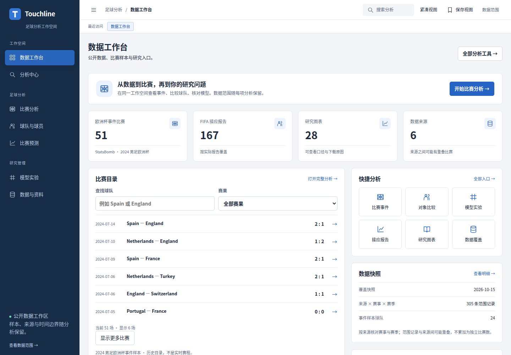

# Soccer Analytics

[浏览结果](#浏览研究页面) · [环境](#环境与命令) · [来源](DATA_SOURCES.md) · [复现](REPRODUCING.md) · [研究结果](results/README.md)

| 想做什么 | 入口 |
| --- | --- |
| 先看公开研究 | 启动下方静态页面，无需完整数据库 |
| 复现某项实验 | [REPRODUCING.md](REPRODUCING.md) |
| 判断数据能支持什么结论 | [DATA_SOURCES.md](DATA_SOURCES.md) |

研究足球比赛、球队与球员，并用有时间边界的实验比较模型。范围包括男足五大联赛、欧冠、欧洲杯、世界杯和 2025 世俱杯。赛果、事件、有限站位快照、连续追踪、官方报告和游戏评分分别解释，不能互相替代。

[数据来源与存储](DATA_SOURCES.md) · [研究结果](results/README.md) · [复现命令](REPRODUCING.md) · [实现与验证记录](IMPLEMENTATION_REPORT.md)

## 浏览研究页面

仓库已包含经过筛选的公开汇总，浏览页面不需要完整数据库。

```bash
python3 -m http.server 8000 --bind 127.0.0.1 --directory docs
```

打开 `http://localhost:8000/`。页面通过 HTTP 读取 JSON，直接双击 HTML 文件不能完成全部检查。



上图为本地桌面实际截图，使用仓库公开摘要。欧洲杯事件属于 2024 历史样本，页面标出的快照日期不代表实时数据或线上部署。

先选一个有限问题：

| 问题 | 页面与可复现范围 |
| --- | --- |
| 已选比分模型与固定进球率基线相差多少 | [模型实验](docs/models.html?experiment=scores-PL&stage=holdout&metric=log_loss#model-lab)，同一组英超历史留出，保留选择规则、结果文件与来源身份 |
| 欧洲杯决赛两队各有多少射门和完成传球 | [比赛事件](docs/matches.html?match=statsbomb-3943043&team=Spain&view=network#match-explorer)，从公开分时段计数重现整场统计 |
| 同联赛、同赛季的球员如何比较 | [对象比较](docs/entities.html?kind=players&league=England&season=2017%2F18&minutes=900&position=Forward#comparisons)，限定至少 900 分钟，保留分钟、观察指标与比较群体 |

只需 Python 3.12，在仓库根目录执行下方命令即可重现这三项公开汇总的比较，无需安装研究依赖、连接数据库或重新训练：

```bash
python3 scripts/reproduce_examples.py --question all
```

输出包含结果、来源文件 SHA-256、样本范围和页面路径。单项问题与解释见[三个公开样本](REPRODUCING.md#public-examples)。


| 入口 | 内容 |
| --- | --- |
| [数据工作台](docs/index.html) | 公开数据摘要、可筛选比赛目录、赛果分布和实际快照日期 |
| [分析中心](docs/studio.html) | 按问题查找分析工具，打开收藏视图与最近访问 |
| [比赛](docs/matches.html) | 2024 欧洲杯事件、FIFA 接应报告、决赛案例 |
| [球队与球员](docs/entities.html) | 同来源、同联赛、同赛季比较，以及球风表示实验 |
| [模型实验](docs/models.html) | 比分、评级、树搜索与校准的时间留出结果，以及事件表示和 xT 诊断 |
| [数据与资料](docs/library.html) | 图表、覆盖、机构方法与论文 |
| [预测与发布检查](docs/predictions.html) | 独立的预测快照、历史验证、市场参考与发布门槛 |

筛选链接可恢复当前视图，数值表支持显示精度下的 CSV/JSON 导出，图表支持放大与完整 SVG 下载。旧 `research.html#…` 链接保留兼容。不同来源和年份的筛选分别生效，研究覆盖日期不会替代预测快照日期。

模型页把历史模型留出与当前搜索准备诊断分开展示。准备诊断正文标明观察时点、来源赛季和获取时刻，逐折表及下载保留训练截点，时间统一为 UTC。获取时刻不代表比赛完赛或结果最早可用时间；旧摘要未记录的时间保持未知。两个摘要来源可分别失败和重试，切换筛选不会重新校验已接收的追溯与搜索摘要。

顶部可搜索分析入口、收起导航或调整显示密度。在分析页调整筛选后，点击“保存视图”并命名，即可从分析中心重新打开同一 URL。收藏与最近访问只保存在当前浏览器；清理网站数据会删除它们，可通过“导出工作区”保留链接和名称。浏览器禁止存储时会显示提示，不会上传收藏。

研究标签页首次打开时读取数据，共用摘要请求会合并。读取超过 12 秒会结束并提供重试，预测页仍须完成整份快照校验后才显示发布结果。移动图表提供可滚动的阅读图面和数值入口；图集附已公开图中文字与标签的分区转录，部分图另有相关公开汇总链接。转录不补造未标注图元的数值。

## 环境与命令

支持 Python 3.12，自动检查使用 Node.js 22 和 Bash。依赖统一声明在 [pyproject.toml](pyproject.toml) 中，按任务选择依赖组。使用 pip 25.1 或更新版本；下方与 CI 固定使用 pip 26.2.2。

```bash
python3 -m venv .venv
source .venv/bin/activate
python -m pip install pip==26.2.2
python -m pip install --group runtime -c config/constraints-main.txt
python -m app.research --help
```

| 依赖组 | 用途与环境 |
| --- | --- |
| `runtime` | API/公开来源、NumPy/SciPy、XGBoost CPU 预测 |
| `research` | 包含 runtime，合并表格模型、调优、追踪解析、绘图和 EBM 研究依赖 |
| `checks` | Ruff 检查工具，可与 runtime 或 research 一起安装 |
| `deep-learning` | 在 research 环境追加 PyTorch，使用官方 CPU 索引安装 |
| `sources` | SoccerData 采集，使用独立环境 |
| `vaep` | socceraction 1.5.3 和 NumPy 1.x，使用独立环境 |

[主环境约束](config/constraints-main.txt)保留已有 Python 3.12 Linux 环境的包版本，不记录分发文件哈希或系统库。runtime 和 research 安装时显式应用该约束；SoccerData 和 VAEP 不套用它。直接依赖版本没有因文件合并而升级。

研究与代码检查使用以下命令。Linux CPU 表示学习再按 [PyTorch 2.8.0 官方说明](https://pytorch.org/get-started/previous-versions/#v280)追加运行时。

```bash
python -m pip install --group research --group checks -c config/constraints-main.txt
python -m pip install --group deep-learning --index-url https://download.pytorch.org/whl/cpu
```

`python -m app.research` 是数据与研究入口，帮助、采集和公开导出不加载预测训练栈。`python -m app.pipeline` 保留原有生产训练、预测、导出和兼容研究命令。具体参数、数据前置条件和隔离环境见[复现命令](REPRODUCING.md)。

重新生成研究站点数据时使用以下命令。它只读取现有结果，不采集数据或重训模型。

```bash
python -m app.research export-research
```

研究导出先校验全部内容并暂存文件，再逐文件替换。普通写入异常会回滚已替换文件，保留上一版。单文件替换是原子的，该流程不保证断电或强制终止后的整批恢复，也不保证并发读者在多个文件之间始终看到同一代内容。

## 系统结构

| 层 | 位置 | 职责与约束 |
| --- | --- | --- |
| 共享基础 | `app/config.py`、`app/file_io.py`、`app/run_receipts.py` | 配置、文件写入和轻量运行身份，不依赖应用命令或页面 |
| 数据 | `app/data_service/` | 来源访问、比赛归一化、追踪格式、快照和仓库，不导入 ML、分析或 Web 层 |
| 科研 | `app/ml/`、`app/analytics/` | 特征、模型、时序评价、战术和绘图，保留各自输入与可解释范围 |
| 应用 | `app/cli/` | 采集、球探/战术、模型研究与调度，重型依赖按命令延迟加载 |
| 发布 | `app/web/` | 按领域校验公开投影，暂存后逐文件替换，普通异常回滚，不递归公开实验目录 |
| 前端 | `docs/*.html`、`docs/assets/` | 页面入口与分目录资源，只读取公开数据 |
| 验证 | `tests/{data,analytics,ml,web,browser}/`、`scripts/` | 按领域组织测试，统一入口检查依赖边界与公开清单 |

分析实现按 `events/`、`tactics/`、`tracking/`、`scouting/`、`representation/` 和 `visualization/` 分目录。已有数据层追踪读取、比赛对象、异常及应用命令入口保留兼容；直接导入内部分析模块时使用新路径。移动代码不会改变坐标、时钟、概率类别顺序、时间留出规则或已有结果文件。新的实现位置见[实现报告](IMPLEMENTATION_REPORT.md)。 观察记录规整由 `data_service/observations.py` 负责，历史采集与来源比较仍在 `history.py`；原有 `history.prepare_observed_history` 导入路径保留。

训练和研究共用时间留出边界计算，各自保留样本门槛与失败处理。模型与普通报告共用原子写入，模型及上一版模型保持私有权限；分析读取使用有明确关闭边界的只读数据库快照。调用入口、模型格式、压缩来源读取和结果可用时间规则保持，具体职责见[复现文档](REPRODUCING.md#project-layout)。

## 模型与运行记录

生产模型保留配方、资产版本与概率质量检查；旧模型按原身份解释。运行收据记录代码、环境、输入哈希和阶段结果。严格结果时点与默认开球顺序是不同路径：前者要求带时区的开球时间和有证据的结果可用时间，后者不证明赛前信息已经到达。前瞻协议登记也不代表未来效果已经成立。

版本兼容、EBM/ALE、严格时点、赛季研究和赛前预测登记的命令见[模型与时点协议](REPRODUCING.md#model-and-timing-protocols)。

`record-forecasts` 在独立私有目录排他创建 `0600` 登记文件，已有路径拒绝覆盖；`search-comparison --private-predictions` 以单文件原子写入创建 `0600` 审计文件。公共汇总保持 `0644`。这些是源码中的本地输出合同，权限、本地时钟与 SHA-256 不构成第三方时间认证，登记成功也不证明预测效益。

## 数据与产物

| 内容 | 位置 | 保留规则 |
| --- | --- | --- |
| 来源原件与下载凭据 | `.tmp/open-data/` 及明确的来源快照目录 | 属于输入，保留原字节、版本和日期 |
| 本地仓库 | `data/` | 与模型、来源原件分别管理，普通检查禁止打开主数据库 |
| 私有实验 | `.tmp/<run>/` 等已有运行目录 | 保留权重、逐场输出和复核证据，不能按 `.tmp` 名称一概清空 |
| 可公开结果 | `results/` | 聚合报告、来源身份和原创图，数值按各自运行解释 |
| 部署副本 | `docs/data/` | 明确白名单导出的 JSON 与图表，重复于结果目录属于必要部署副本 |
| 可再生缓存 | `__pycache__/` 等 | 验证与使用状态核对后可删除 |

原始数据、完整身份关联、个体预测、模型二进制和浏览器证据不进入公开清单。历史路径属于来源凭据，本轮没有为目录统一而移动原件或实验记录。详细覆盖和授权边界见[数据来源](DATA_SOURCES.md)。

体能跨源验证的速度汇总使用 `observed_duration_weighted_mean_match_p99_speed_mps`，表示按观测时长加权的逐场 p99 均值，单位为 m/s。旧汇总键 `p99_speed_mps` 保留为数值相同的兼容别名，并通过 `p99_speed_mps_alias_of` 标明含义。逐场 p99 字段不变，这个跨场均值不等于合并全部速度样本后的 p99。

## 检查与维护

先安装相应依赖，代码检查工具使用 `python -m pip install --group checks`。基础环境也使用同一检查命令，只有实际需要可选包的检查才跳过。

```bash
python scripts/check.py
python scripts/check.py tests.web.test_research tests.web.test_delivery
python scripts/check.py --lint
python scripts/check.py --static-only
```

默认入口运行全部 unittest，再检查全部前端脚本、页面资源、文档链接和公开文件身份。测试只使用受控样本及隔离文件，拒绝访问主 `data/football.sqlite3` 和 WAL/SHM。可选依赖按实际执行范围跳过，缺少优化器不会隐藏基础校准、比分或数值诊断。零测试收集和检查未完成会失败。

真实界面检查使用 Node.js 22.12 或更新版本。开发依赖固定在 `package-lock.json`，包含 Playwright 与 Axe；正式页面不加载这些包。先安装开发依赖和所需的 Chromium，再运行原有检查入口：

```bash
node --version
npm ci --ignore-scripts --no-audit --no-fund
npx playwright install chromium
python scripts/check.py --static-only --browser
FRONTEND_CASE=entity-search-and-selection-restoration node tests/browser/acceptance.cjs
```

也可用 `PLAYWRIGHT_CHROMIUM_EXECUTABLE` 显式指定已有 Chrome/Chromium，省去浏览器下载；`PLAYWRIGHT_MODULE` 继续支持指定已有 Playwright 模块，Axe 仍由上述项目依赖提供。脚本不搜索任意 npm 缓存、不自动安装组件，只启动并关闭自有隔离浏览器和 localhost 服务。`FRONTEND_CASE` 可筛选场景，未知名称或空选择会失败。输出包含布局、交互、导出与 `accessibility.json`；Axe 的违规项会使检查失败，待人工复核项单独保留，自动检查不代表全站合规认证。

比赛页的时间条使用现有公开 15 分钟摘要。选择一列会同步下方射门图、传球网络或矩阵、数值表、导出与 URL；再次选择或清除时段可恢复全场。补时归入对应半场最后一段，加时单列。传球时间条显示全队完成传球，球员与联系门槛仅作用于下方图表。A/B 比较在页面和 SVG 中共用颜色角色、文字标识与不同图形或纹理；数值表保留单位和当前筛选范围。

新增或修改公开文件后，显式刷新并复核清单。刷新只发现源码与文档，不自动把新实验数据加入公开范围。

```bash
python scripts/public_manifest.py --refresh
python scripts/public_manifest.py
```

`checks.yml` 在基础和研究环境运行完整检查入口，研究环境已包含 EBM/ALE 验证，独立浏览器任务按 npm 锁文件安装开发依赖并运行界面与 Axe 检查。手动触发时可打开 `optional_dependencies`，分别检查 PyTorch CPU、VAEP 和 SoccerData 三种独立环境。GitHub Pages 自动发布已取消，分析界面仍可按上文在本地浏览。Daily model refresh 保持停用，不因源码推送启动采集或训练。本地检查通过不代表模型效益或线上部署。

贡献修改时，请说明行为变化、所用依赖环境和实际运行的检查。沿用现有测试补足相关边界，完成一组修改后集中验证。数据与产物更新须保留来源、日期、单位和方法范围，先更新研究结果，再按导出契约更新页面副本与公开清单。原始数据、主数据库、模型和私有实验记录继续留在本地。具体命令和检查范围见[维护入口](REPRODUCING.md#maintenance-interfaces)。

## 研究状态

原始范围保留的 49 篇论文及相关资料已完成约定阅读；后补 ALE、GA2M、DOT 与 AgentTune 后，全文已读论文共53篇。无法补齐的三项仍按用户要求排除。适用实现、扩展候选和实际访问限制分别记在[实现报告](IMPLEMENTATION_REPORT.md)与[参考目录](results/resource-reviews.json)。闭源产品只借鉴公开资料，不声称取得订阅数据或复现内部模型。

AgentTune全文现已读完。已加入共同起点的Random、GP、TPE、GA与width=1/2局部beam研究入口，以及真实拟合成本和开发期外层检验；本轮工程集中验证已通过。规整真实观察记录并显式保留初始训练区间后，单个PL队列的时间准入已通过；冷启动与小验证样本仍不足以给出采用排名。默认搜索保持原样，DOT、低保真与持久试验缓存继续暂缓。复现入口见[严格搜索对照](REPRODUCING.md#strict-search-comparison)，范围与进度见[实现报告](IMPLEMENTATION_REPORT.md#search-implementation-20261025)。

本地公开准备摘要对应 2026 赛季英超的70场规整比赛，观察截点为 `2026-10-26 00:29:08.025013 UTC`：60场开发标签、50场去重训练、10场内层验证和10场开发期外层。时间准入通过，准备状态仍为 `insufficient`，未执行真实搜索拟合。页面保留该次诊断的原代码和协议身份；当前源码的界面或权限维护不会改写历史报告。受控测试和本地 Chrome 验证不代表未来收益、远端 CI 或已发布网站验收。

[10 月 19 日离线结果](results/paper-followup-20261019)来自同一英超 2025/26 快照，包含比分、评级、校准、可选树搜索和固定输出解释。它们不替代既有五联赛结果、生产模型或当前赛季预测。历史实验细节与结论统一在[结果说明](results/README.md)，本轮维护和验证状态见实现报告。
