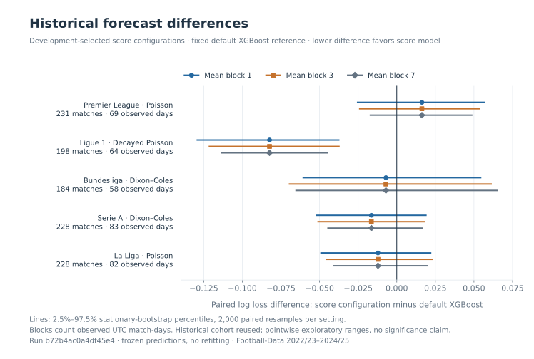
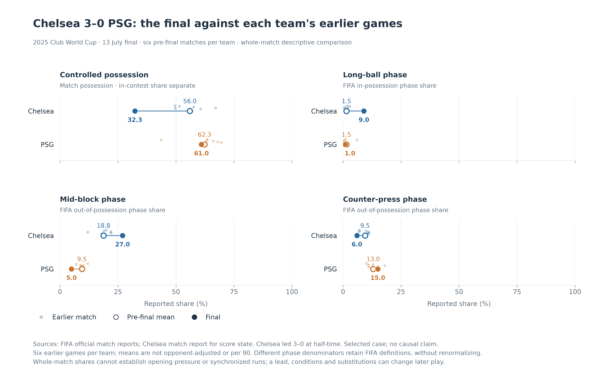
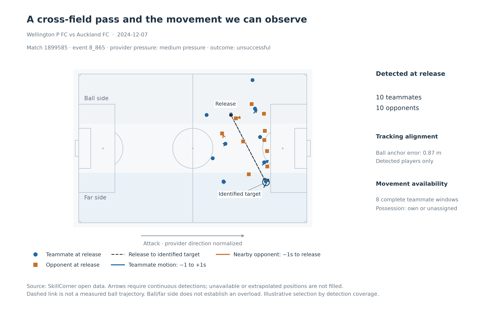
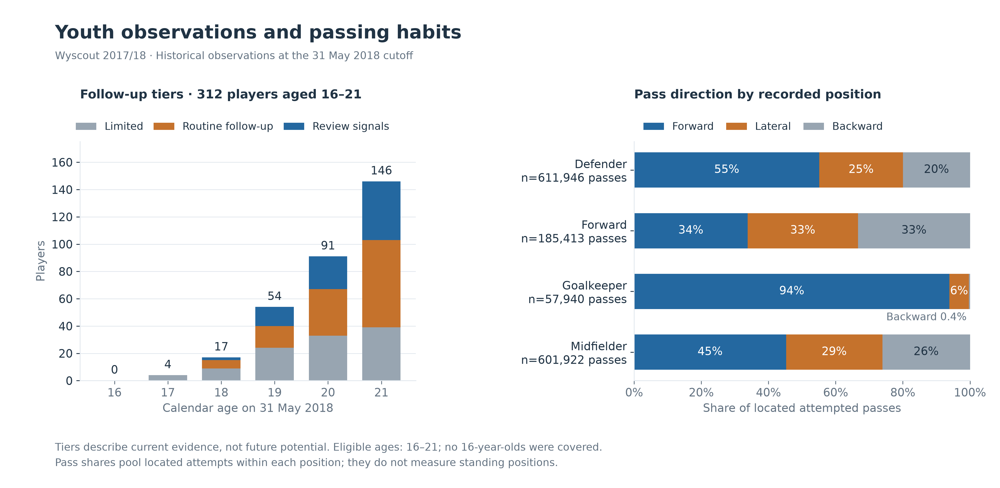
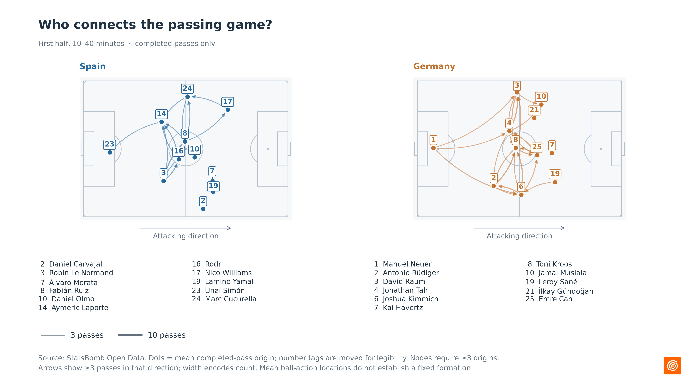
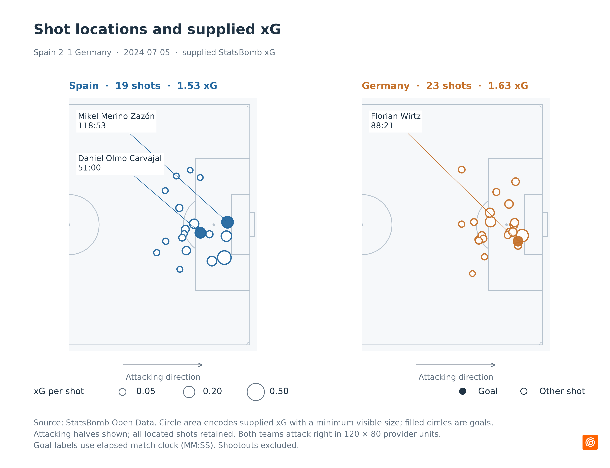
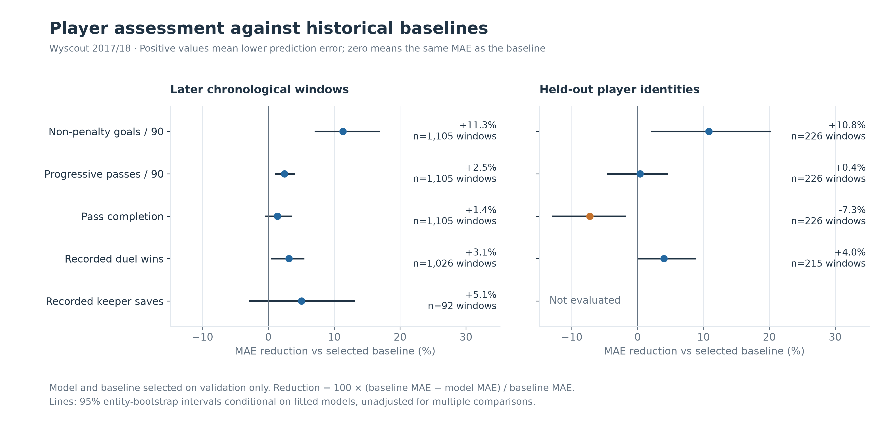
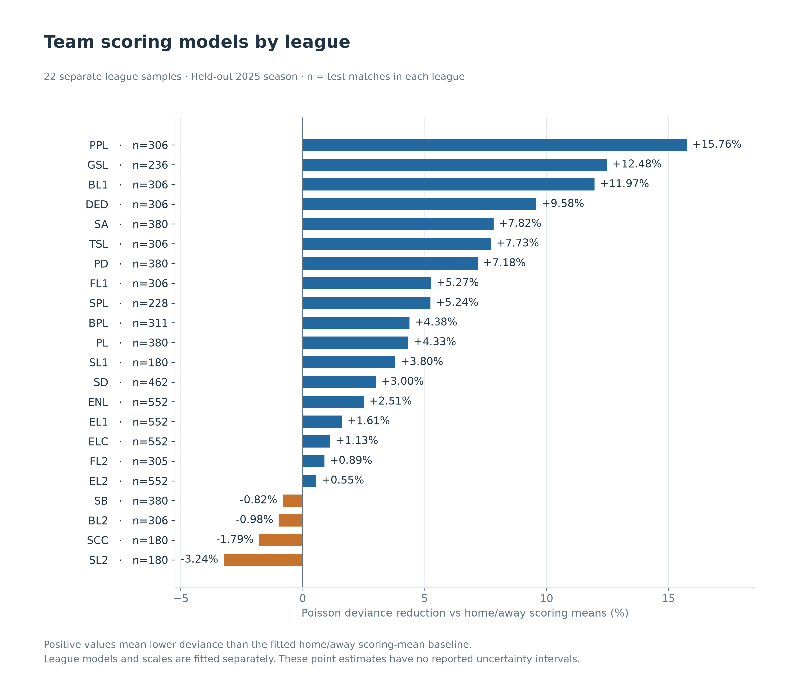
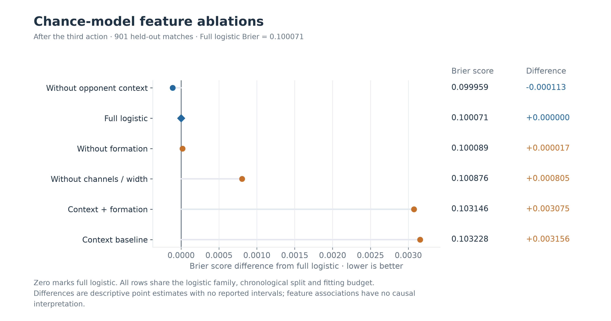
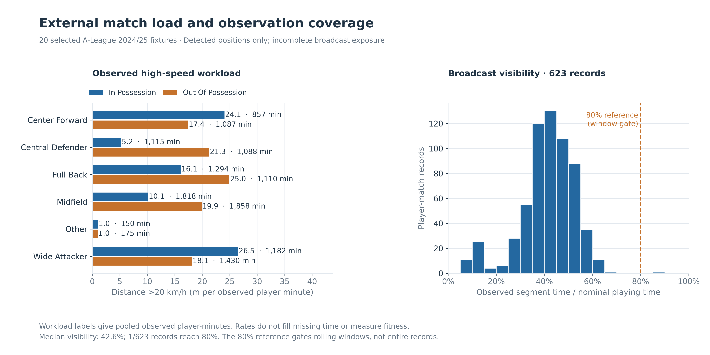

# 足球分析结果

本目录按运行保留结果，文件名中的日期和 JSON 中的来源身份决定其样本范围。`docs/data/research` 是白名单部署副本，不作为第二次实验计数。10 月 20 日的系统重构只迁移实现职责和检查流程，没有重算下文指标或改写已有结果。当前页面入口见[项目 README](../README.md)。

10月19日完成本轮实现与集中验证，[实现报告](../IMPLEMENTATION_REPORT.md)逐项记录证据和边界。[本轮结果目录](paper-followup-20261019)保存同一英超2025/26校验快照上的五种比分模型、12个评级配置、6种校准方法、9个可选树/特征搜索配置，以及固定主胜减客胜的32场全局解释摘要和四类图表。它们是独立的新结果，不能并入下文既有五联赛表格冒充统一重算。

ODIR的固定归一化正则、Brier分箱分解与有符号余项、比赛日ACF/HAC、共用进球率和双变量Poisson均通过独立数值验证。比分频数保留完整`4+`与其他比分尾项；点拟合不提供后验区间。运行成本逐折和逐trial记录，选择只使用开发期损失。单场贡献可闭合并展开完整表；全局贡献使用固定输出，显式交互按原生半对约定解释，不作为概率百分点或因果效果。

真实浏览器检查覆盖接应条形图、指标/实验点图、手机横向滚动、数值表/CSV和传球/射门序列SVG，中圈按StatsBomb原生半径10绘制。占用图标明实际20×12网格且未平滑；空间基底标明50×50、sigma为网格单位、nearest显示和固定4/4/5/5分量。基底沿用原产物重绘，未重新执行NMF或本地70%解释方差选择。下文旧诊断文件仍保留原版本。

新增全文阅读包括编号 30、L15–L17 和 L20。L18 的必要补充表未取得，现按用户要求从本轮排除；已读正文结论保留。概率质量、校准、场景开发与独立验收分别记录。

本轮论文阅读已收尾：原始 52 篇中，按用户要求排除编号 06、L18、L22 三项无法补齐的材料，保留的 49 篇均已全文阅读，所列版本附录和八篇独立官方补充材料已读完。三项排除资料保留实际范围与已有结论，不记成全文已读。来源、版本、限制、代码线索和候选扩展见实现报告；Elo 使用原文网页与离线派生阅读副本，未取得原始 PDF 字节。本轮临时文件已清理，有用原文和数据快照保留。这段阅读于 10 月 18 日按用户要求暂停，10 月 19 日收到实现指令后已继续完成适用实现和集中验证，证据见文首结果与实现报告。

10 月 18 日的[OpenFootball 数据与采集复核](openfootball-review.json)读取同一固定提交下的全部八联赛 2026/27 JSON，保留 2,916 场赛程、470 场已记录结果和 441 组半场比分。轮次和半场数据此前会在归一化时丢掉，现在已保留，并区分半场缺值、非法值与半场大于全场的情况。附加比分代码原样保存，不覆盖 score.ft。

| 联赛 | 赛程总数 | 已记录结果 | 带半场比分 | 缺少比分且来源日期早于采集日 |
| --- | ---: | ---: | ---: | ---: |
| 英超 | 380 | 50 | 45 | 15 |
| 法甲 | 306 | 45 | 41 | 13 |
| 德甲 | 306 | 36 | 33 | 16 |
| 意甲 | 380 | 50 | 50 | 14 |
| 西甲 | 380 | 69 | 64 | 15 |
| 英冠 | 552 | 95 | 88 | 36 |
| 荷甲 | 306 | 63 | 62 | 13 |
| 葡超 | 306 | 62 | 58 | 10 |

这些文件的最后一场已记录结果均为 9 月 20 日。即使今天重新下载，也不能据此声称结果完整覆盖到今天。132 场缺分记录的来源日期已过去，没有把它们判定为真实的未来赛程。日期字段和待定时间也未擅自补成精确开球时刻。

本轮固定了 football.json 的提交及目录凭据，确认其 2026/27 目录只有八个联赛文件，没有欧冠文件。另核对欧冠源仓库的固定提交，其目录只到 2025/26。因此当前来源不能完成本季欧冠更新，后续需要核对其他供数渠道，不能沿用旧赛季冒充新数据。

补充五个明确的球队名称映射后，五大联赛的 250 场结果与上一轮 CSV 快照全部匹配，比分无冲突；英冠、荷甲和葡超未做这项跨来源对照。映射仅用于对照键，没有合并或改写供数方 ID，仍保留对真实更名或分立球队的歧义保护。八联赛数据独立核对了 17,496 个核心字段、882 个半场值、470 行既有赛前特征和 24 个无损导出文件，原始文件也逐个匹配了固定目录的 Git blob 哈希。另修复了跨多个赛季查询只取首尾两季的问题；精确时间查询仍排除只有日期的记录。

10 月 18 日的[平局校准对照](draw-calibration.json)复用五联赛 2022/23 至 2024/25 的 5,330 场比赛、1,069 场最终留出比赛。两种基础模型各比较原始概率、温度、Dirichlet、固定平局率、logistic 平局校准和 Beta 平局校准，共 60 条评估。基础模型使用独立校准窗口之前的训练前缀，每组方法共享相同的基础概率。

下表是留出比赛的平局 log loss，越低越好。固定平局率取自校准窗口。开发集仍按完整胜平负 log loss 选方法，表中的留出成绩不参与选择。

| 基础模型 | 联赛 | 原始概率 | 固定平局率 | Logistic 平局 | Beta 平局 | 开发集所选 |
| --- | --- | ---: | ---: | ---: | ---: | --- |
| XGBoost | 英超 | 0.566951 | 0.539014 | 0.539014 | 0.539014 | 固定平局率 |
| XGBoost | 法甲 | 0.536648 | 0.490460 | 0.490460 | 0.490460 | 固定平局率 |
| XGBoost | 德甲 | 0.599507 | 0.574795 | 0.574460 | 0.574488 | 固定平局率 |
| XGBoost | 意甲 | 0.642463 | 0.593884 | 0.593265 | 0.593012 | Logistic 平局 |
| XGBoost | 西甲 | 0.564054 | 0.567329 | 0.562568 | 0.559011 | Dirichlet |
| L2 逻辑回归 | 英超 | 0.550308 | 0.539014 | 0.537925 | 0.536452 | 温度 |
| L2 逻辑回归 | 法甲 | 0.575832 | 0.490460 | 0.490460 | 0.500397 | 温度 |
| L2 逻辑回归 | 德甲 | 0.599988 | 0.574795 | 0.574647 | 0.574298 | 温度 |
| L2 逻辑回归 | 意甲 | 0.626634 | 0.593884 | 0.593164 | 0.592424 | Logistic 平局 |
| L2 逻辑回归 | 西甲 | 0.607356 | 0.567329 | 0.566588 | 0.571127 | 温度 |

Beta 在这批比赛的平局 log loss 均低于原始概率，与 logistic 相比有 5 组较低、3 组较高、2 组在 1e-9 范围内相同。部分模型的拟合斜率为零，退化成固定平局率。开发集对三组选择固定平局率、两组选择 logistic、四组选择温度、一组选择 Dirichlet，没有选中 Beta。先前两组 Beta 与 logistic 的开发集差值只有约 1e-12，现在通过明确的数值容差优先选择参数更少的方法，避免把浮点误差当作方法优势。

10 月 18 日补读完 [Beta calibration 正文 9 页](https://proceedings.mlr.press/v54/kull17a/kull17a.pdf)与[补充材料 13 页](https://proceedings.mlr.press/v54/kull17a/kull17a-supp.pdf)。本地 `draw_logistic` 使用原始平局概率，映射为 `sigmoid(a*s+c)`；Beta 使用 `sigmoid(a*log(s)-b*log(1-s)+c)`。对 `logit(s)` 做 logistic 则属于等斜率 Beta 家族，不能与这里的原始概率对照混用。后续摘要增加了输入变换和公式说明，当时数值计算保持原样。相应适用修正已在 10 月 19 日集中验证，不再属于待测试状态。

本地加入固定系数正则化，并把二分类输出接回胜平负概率，保持非平局时的主客胜比例。它只校准平局事件，不保证整组三类概率已经联合校准，也没有复现论文全部实验。首次五种方法的留出结果已查看，随后才补充固定平局率基线与数值并列规则，因此最终对照属于探索性复核。

旧的 30 组留出概率完整一致。独立 SLSQP 数值导数拟合核对了 80 个学习型平局映射，另核对 40 个固定平局率窗口和 480 个留出指标，最大指标差为 3.64×10⁻¹⁷。复核还发现并修正了优化器在解已满足约束梯度条件时误报失败的问题，当前会保存优化器状态，并以有限值、约束和梯度检查决定拟合是否有效。这批历史比赛已用于此前研究，结果不构成未来表现优势的证据。

10 月 17 日的[xG 字段保留与质量复核](match-xg-provenance.json)修复了 HxG/AxG 在 CSV 归一化时丢失的问题。没有新增下载，而是重新解析上一轮保存的五联赛 2026/27 原始 CSV。297 场比赛的 594 个值经独立 SQL 投影逐项核对，15 个源文件与快照通过无损导出检查，原有 30 项赛前特征的 297 行保持一致。

缺列、空值和非法值分别记录，零值有效，比赛层面的数值允许大于一。部分缺失或非法的 xG 不会删除比赛，只读汇总仅纳入已完赛、两侧有效且来源标记一致的记录。每份资产单独统计，不合并不同快照版本。

本轮选读 [Cavus 与 Biecek 的 xG 定义及数据要求](https://arxiv.org/html/2206.07212v2)，并借鉴 Pandera 的可选字段、空值与跨列检查文档。官方字段说明中未找到 HxG/AxG 的完整定义，模型来源、点球处理和数据可用时间仍待核实。因此这里只保留供数方字段并标记赛后用途，没有复现射门模型或接入预测特征。隔离小库保留原始 CSV、旧快照和新快照，主数据库、生产模型与站点保持原样。

10 月 17 日的[快照新鲜度与赛季更新](snapshot-freshness.json)给单赛季采集和批量 CSV ZIP 采集加入显式 TTL。默认仍复用经过校验的固定快照；设置全局或当前赛季寿命后，到期才重新下载。旧时间无效、来自未来或缺少 ZIP 下载凭据时，有限 TTL 不会把它当作新鲜缓存。

本轮实际获取了五大联赛 2026/27 的 297 场已完赛比赛，独立保存于任务目录，没有改动主数据库、生产模型或站点。以下是服务端 CSV 当前给出的范围；10 月 17 日下载，不等于数据完整覆盖到当天。

| 联赛 | 2026/27 已完赛场次 | CSV 内最新开球日期（UTC） |
| --- | ---: | --- |
| 英超 | 60 | 2026-10-12 |
| 法甲 | 54 | 2026-10-11 |
| 德甲 | 45 | 2026-10-11 |
| 意甲 | 60 | 2026-10-12 |
| 西甲 | 78 | 2026-10-12 |

再次运行同一采集命令时，五份新鲜快照全部命中，实测网络请求为零，快照哈希保持一致。另取原始 CSV，用独立解析核对了每场比赛的球队、日期、开球时间和比分，共 1,782 个字段；此前研究使用的 15 份历史快照也通过了原凭据核验。

两层缓存现在联动刷新：ZIP 到期更新后会重新解析联赛 JSON。复核还修掉了“ZIP 已更新，缺少档案哈希的旧 JSON 却被标为新鲜”的问题。有限 TTL 失败时排除失败项并保留旧 JSON；坏 ZIP 通过校验前不会覆盖旧 ZIP。有效 ZIP 的某个成员解析失败，仍会单独报告失败，不能把整批当作原子事务。

没有启用失败时回退旧响应。旧 ZIP 没有可信下载时间时，新生成 JSON 的 fetched_at 为 null，normalized_at 只表示本地解析时间。11 个真实本机 HTTP 场景、14 次请求验证了缓存命中、到期更新、损坏内容、失败后重试与文件保留；时钟由测试控制，没有实际等待六小时。requests-cache 仍未运行，这里只借鉴其过期策略文档。

10 月 17 日的[概率分箱诊断](calibration-diagnostics.json)复用校准实验的全部冻结概率：五联赛、两个基础模型、三种校准方式，共 30 条序列、90 次分辨率评估。各模型和校准方式共享同一批 1,069 场最终留出比赛，没有重训或重新选择模型。

[二维可靠性图](calibration-diagnostics.svg)把整组客胜、平局、主胜概率放在同一个三角形中。空心圆表示分箱内的平均预测，箭头指向实际赛果比例，圆面积表示样本数。图中只显示至少 10 场的分箱；顶部计数交代了可见样本，TV 指标仍使用全部比赛。

下表为图中固定英超 XGBoost 案例的三类别平均 ECE，单位为概率百分点。等频分箱按预测值的累计数量选边界，相同概率不会拆开，因此实际分箱数可以少于请求数。

| 分箱数 | 原始等宽 | 温度等宽 | Dirichlet 等宽 | 原始等频 | 温度等频 | Dirichlet 等频 |
| --- | ---: | ---: | ---: | ---: | ---: | ---: |
| 5 | 7.40 | 6.42 | 7.37 | 7.33 | 6.99 | 7.54 |
| 10 | 7.90 | 8.06 | 7.67 | 9.36 | 9.66 | 9.09 |
| 20 | 7.92 | 9.03 | 8.26 | 11.47 | 11.13 | 11.94 |

同一批概率使用 5、10、20 个等宽分箱时，数值最小的方式依次为温度缩放、Dirichlet、未校准。这个顺序变化说明诊断受分箱影响，不能据此重新选模或宣布某种方式的真实校准更好。等频分箱也没有消除有限样本噪声。联合 TV 与类别平均 ECE 的条件信息和尺度不同，不直接比较大小。

本轮选读 [Vaicenavicius 等（2019）](https://proceedings.mlr.press/v89/vaicenavicius19a/vaicenavicius19a.pdf)的反例、校准定义、分箱估计及可视化方法。测试复现了“边际与最高概率 ECE 为零、联合偏差仍为 0.1”的反例。本地采用三项概率对称网格和保留相同分值的近似等频边界，没有复现论文全部实验、假设检验或一致性重采样；文中的渐近结论也不能充当这里有限样本误差的界。

独立字典与逐项求和核验了 810 个 ECE、6,208 个可见分箱和 15,382 个数值字段，最大差为 5.55×10⁻¹⁶。30 份旧指标完整一致，10 个冻结概率文件保持原样；新摘要会附加到今后的校准报告中，原有选择标准仍是开发集 log loss。

10 月 17 日的[有序 Elo 概率基线](ordinal-elo.json)将赛前 Elo 差值映射成客胜、平局、主胜三项概率，补充原有只输出类别的 Elo 基线。研究复用 2022/23 至 2024/25 五联赛快照，共 5,330 场、1,069 场最终留出比赛；四种固定配置形成 20 条评估。

下表为最终留出比赛的 log loss，越低越好。前两种模型仅用 Elo 差值，后两种使用现有 30 项特征。模型只按开发集的三个时间扩展窗口选定：英超、法甲、德甲选中有序 Elo，意甲、西甲选中 Elo 多项逻辑回归。

| 联赛 | 有序 Elo | Elo 多项逻辑回归 | 全特征 L2 | 默认 XGBoost |
| --- | ---: | ---: | ---: | ---: |
| 英超 | 1.0032 | 0.9995 | 1.0187 | 1.0002 |
| 法甲 | 0.9855 | 0.9896 | 1.0772 | 1.0571 |
| 德甲 | 1.0707 | 1.0859 | 1.1342 | 1.0583 |
| 意甲 | 0.9738 | 0.9754 | 1.0089 | 1.0152 |
| 西甲 | 0.9862 | 0.9952 | 1.0493 | 1.0094 |

有序 Elo 的留出损失在五个联赛都低于全特征 L2，在三个联赛低于默认 XGBoost，在四个联赛低于 Elo 多项逻辑回归。比较同时涉及特征数、缩放与正则化，不能把差异全部归因于有序模型；一组固定种子和已经反复使用的历史比赛，也不能证明未来赛季优势。开发集选定的模型保留，不按这张表重新选择。

本地实现依据 statsmodels 官方文档的累积概率公式，使用 SciPy 拟合，没有安装或运行 statsmodels。2010 年原论文只读到官方摘要与导言预览，全文访问返回 403，因此这里不声称复现原文。岭惩罚、参数范围、现有 Elo 更新和冷启动都是本地选择；比分差更新、球员评级与置信区间尚未加入。

集中核验包括两项有明确目的的回归测试，以及直接阈值参数化与 SLSQP 优化器的 20 次独立拟合。独立拟合与本地模型的最大概率差为 4.37×10⁻⁷；80 个留出指标用 NumPy 重算，最大差为 2.22×10⁻¹⁶。10 条旧 L2/XGBoost 对照序列的 2,138 行概率逐值保持一致。留出历史按更早开球结果推进，比赛结束及结果到达时间仍未验证；本轮没有更新数据、替换生产模型或发布站点。

10 月 17 日的[特征与模型联合调参](feature-search.json)比较固定默认、只调模型和联合调参。五联赛使用相同的 2022/23 至 2024/25 三季快照，共 5,330 场、1,069 场最终留出比赛。XGBoost 与 L2 逻辑回归各用三个固定随机种子；每次搜索尝试 12 组参数，共 90 条配置评估、720 次搜索尝试。

下表为三个种子的平均胜平负 log loss，越低越好。每次搜索只按开发集的三个时间扩展窗口选择参数，随后才评估留出比赛。

| 联赛 | 模型 | 固定默认 | 只调模型 | 联合调参 |
| --- | --- | ---: | ---: | ---: |
| 英超 | XGBoost | 1.0031 | 1.0024 | 1.0522 |
| 英超 | L2 逻辑回归 | 1.0187 | 0.9906 | 0.9908 |
| 法甲 | XGBoost | 1.0440 | 1.0392 | 1.0386 |
| 法甲 | L2 逻辑回归 | 1.0772 | 1.0190 | 1.0143 |
| 德甲 | XGBoost | 1.0545 | 1.0463 | 1.0549 |
| 德甲 | L2 逻辑回归 | 1.1342 | 1.0926 | 1.0919 |
| 意甲 | XGBoost | 1.0088 | 1.0095 | 1.0085 |
| 意甲 | L2 逻辑回归 | 1.0089 | 1.0032 | 1.0006 |
| 西甲 | XGBoost | 1.0126 | 1.0133 | 1.0135 |
| 西甲 | L2 逻辑回归 | 1.0493 | 1.0026 | 1.0013 |

联合调参在 10 组联赛与模型对照中的 6 组降低了平均损失，其余组没有改善。15 次开发集选择中，11 次选中只调模型，4 次选中联合调参，基础模型均为 L2 逻辑回归。报告保留每个种子的成绩、参数及搜索历史。三个种子复用同一批比赛，范围只是运行敏感性，不是置信区间；这批历史比赛也已用于此前研究，不能据此声称未来赛季优势。

联合搜索增加最近 2–12 场的状态窗口、Elo 更新幅度和期望中的主场偏移。窗口不是训练赛季数；较大的搜索空间在同样 12 次尝试下也更难搜索。两种搜索还可能选到不同模型参数，因此差值不能全部归因于 Elo 或窗口本身。开发集选定的方案不会按留出成绩换掉。

每个候选单独重建开发历史，选定后才生成留出特征。留出期间模型固定，球队历史按更早开球比赛的结果推进；开球较早不保证比赛已结束或结果已到达，实时可用性仍待验证。研究不导出生产模型包，也没有补采、入库或替换线上预测。

10 月 17 日的[采集重试复核](http-retry-policy.json)依据 Tenacity 的退避实现和 HTTP 标准，修正了 API 与公开文件忽略日期型 `Retry-After`、档案下载重复请求永久错误的问题。三条路径现在共用带抖动的有界退避；有效的服务端等待提示不会被截短，超过本次等待上限时保留提示并停止。本机真实 HTTP 检查覆盖 27 个情景、52 次请求与 40 个失败响应的关闭，时钟和等待由测试控制。本次没有连接真实供数方、刷新比赛数据或改动模型。

10 月 17 日的[配对损失比较](outcome-comparison.json)继续使用已经冻结的五联赛预测。共 1,069 场比赛，25 条模型概率序列，20 组模型与默认 XGBoost 的配对比较。逐场计算 log loss、Brier 和 RPS，保留 180 个重采样范围及 240 个 Bartlett 标准误，没有重训模型。

下表为开发集选定的比分配置减去默认 XGBoost 的 log loss。负数表示这批比赛中的损失较低。块长按连续的观测 UTC 比赛日计，每天的比赛整体保留，每次抽样按抽到的比赛数汇总。

| 联赛 | 所选比分配置 | 平均差值 | 块长 1 的范围 | 块长 3 的范围 | 块长 7 的范围 |
| --- | --- | ---: | --- | --- | --- |
| 英超 | Poisson | +0.0163 | [-0.0258, +0.0571] | [-0.0245, +0.0541] | [-0.0175, +0.0490] |
| 法甲 | 时间衰减 Poisson | -0.0824 | [-0.1296, -0.0371] | [-0.1218, -0.0370] | [-0.1140, -0.0444] |
| 德甲 | Dixon–Coles | -0.0070 | [-0.0610, +0.0548] | [-0.0699, +0.0616] | [-0.0657, +0.0653] |
| 意甲 | Dixon–Coles | -0.0164 | [-0.0523, +0.0194] | [-0.0514, +0.0186] | [-0.0450, +0.0170] |
| 西甲 | Poisson | -0.0122 | [-0.0495, +0.0224] | [-0.0458, +0.0236] | [-0.0412, +0.0201] |

范围是每种设置下 2,000 次 stationary bootstrap 的逐项 2.5%–97.5% 百分位。德甲、意甲、西甲的三个范围都跨过零，平均分数的小幅下降尚不足以说明稳定优势。法甲的三个范围保持为负，但参照和显示配置在此前结果已知后确定，这批比赛也已反复用于研究，不能据此给出多重比较或未来赛季的显著性结论。报告保留所有配置，不按这次范围重新选模。

方法参考 [Diebold–Mariano](https://doi.org/10.1080/07350015.1995.10524599) 的配对损失与长期方差，以及 [Politis–Romano](https://doi.org/10.1080/01621459.1994.10476870) 的随机长度连续块重采样。另选读了 [2026 年 ForeComp 预印本](https://arxiv.org/abs/2603.07458)关于带宽和小样本推断的讨论。本地实现把比赛按 UTC 日期归组，并以整天损失总和和比赛数构造加权差值，属于适配，未复现原始 DM 检验、fixed-b 临界值或 ForeComp 基准。观测比赛日之间实际有 12–19 天的最大间隔，重采样的循环边界和跨场球队相关仍是限制。

独立复算将抽到的整天重新展开为逐场记录，检查 660 个差值、范围端点和标准误，最大差约 1.1×10⁻¹⁶。另重算了 75 个旧指标，原始预测和成绩保持一致。图的重绘入口为 `python -m app.analytics.visualization.outcomes`，输出 SVG 和 PNG。

10 月 17 日的[比分模型对照](score-models.json)比较球队攻防 Poisson、时间衰减 Poisson 和 Dixon–Coles 低比分修正。使用 Football-Data 的 2022/23 至 2024/25 三季快照，共 5,330 场比赛，最终留出 1,069 场。三种配置共完成 15 条评估、60 次拟合。

| 联赛 | 开发集所选配置 | 留出场次 | Poisson | 时间衰减 Poisson | Dixon–Coles | 既有默认 XGBoost |
| --- | --- | ---: | ---: | ---: | ---: | ---: |
| 英超 | Poisson | 231 | 1.0165 | 1.0030 | 1.0026 | 1.0002 |
| 法甲 | 时间衰减 Poisson | 198 | 0.9864 | 0.9747 | 0.9790 | 1.0571 |
| 德甲 | Dixon–Coles | 184 | 1.0617 | 1.0550 | 1.0513 | 1.0583 |
| 意甲 | Dixon–Coles | 228 | 0.9933 | 1.0005 | 0.9988 | 1.0152 |
| 西甲 | Poisson | 228 | 0.9973 | 0.9974 | 0.9972 | 1.0094 |

表内均为胜平负 log loss，越低越好。所选配置在开发集的三个时间扩展窗口中锁定，英超和西甲没有因留出成绩改选。XGBoost 数字复用正则化实验中冻结的默认配置预测，并核对逐场身份和标签；它没有参与这次选模。各报告的配置与训练样本不同，成绩应分别阅读。

所选比分配置在五个联赛中的四个低于这条默认 XGBoost 对照，英超较高。这些模型的完整配置不同：比分参数在评价窗口内固定，XGBoost 使用原有滚动特征和训练类别权重，不能把差异全部归因于模型家族。Dixon–Coles 相比同样衰减的 Poisson，在四个联赛降低了胜平负损失，法甲变差；德甲的确切比分损失却变差，说明两个目标需要分别评价。

模型使用对数攻防强度、主场效应及本地加入的正则化与参数边界。衰减半衰期固定为 365 天，没有调参；训练中未见过的球队采用平均对数强度回退。胜平负使用完整概率支持，未截断比分网格后重新归一化。独立检查覆盖 3,207 组比分网格、220 个指标值及 2,960 个已知或未知球队配对的低比分概率约束。资料依据为 [Maher](https://doi.org/10.1111/j.1467-9574.1982.tb00782.x)、[Dixon–Coles](https://research.lancaster-university.uk/en/publications/modelling-association-football-scores-and-inefficiencies-in-the-f/)的选读方法部分，以及 [penaltyblog](https://github.com/martineastwood/penaltyblog) 的模型接口与拟合封装。没有复现原论文数据或收益结果，也未安装或复制上游代码。这些快照已用于早前研究，结果不构成未来赛季优势证据。

10 月 17 日的[赛果概率校准对照](match-calibration.json)比较原始概率、温度缩放和 Dirichlet L2 校准。五联赛共 5,330 场历史比赛，最终留出 1,069 场。XGBoost 与 L2 逻辑回归分别使用固定默认参数，形成 10 组比较、30 条方案评估。

| 联赛 | 基础模型 | 开发集所选校准 | 留出场次 | 原始 log loss | 所选方案 log loss |
| --- | --- | --- | ---: | ---: | ---: |
| 英超 | XGBoost | Dirichlet L2 | 231 | 1.0207 | 1.0105 |
| 法甲 | XGBoost | Dirichlet L2 | 198 | 1.0544 | 1.0017 |
| 德甲 | XGBoost | Dirichlet L2 | 184 | 1.0761 | 1.0994 |
| 意甲 | XGBoost | 温度缩放 | 228 | 1.0449 | 1.0428 |
| 西甲 | XGBoost | Dirichlet L2 | 228 | 1.0056 | 1.0115 |
| 英超 | L2 逻辑回归 | 温度缩放 | 231 | 1.0342 | 0.9977 |
| 法甲 | L2 逻辑回归 | 温度缩放 | 198 | 1.1280 | 1.0735 |
| 德甲 | L2 逻辑回归 | 温度缩放 | 184 | 1.1329 | 1.0991 |
| 意甲 | L2 逻辑回归 | 温度缩放 | 228 | 1.0342 | 1.0087 |
| 西甲 | L2 逻辑回归 | 温度缩放 | 228 | 1.1082 | 1.0334 |

log loss 越低越好。每个开发回测窗口分为更早的基础模型训练段、随后的校准拟合段，再用更晚的比赛比较方案。所有方案共享同一基础模型及原始概率，按开发集汇总 log loss 选定后再计算最终留出结果。最终拟合也保留独立校准段，没有在校准后用全部开发集重训基础模型。

本次 10 组固定配置的对照中，所选方案在 8 组降低了留出 log loss，XGBoost 的德甲和西甲结果变差。独立复算了 330 个指标值及 1,842 个可靠性表数值。报告保留 9、10、11 箱 ECE、分类可靠性和各次拟合状态。这些历史快照曾用于其他研究，本次只用一个种子。校准段减少了基础模型的训练样本，因此不能直接与其他报告的完整开发集重拟合成绩比较。这次未替换生产模型。

10 月 17 日的[赛果正则化与调参对照](regularized-search.json)使用 Football-Data 的 2022/23 至 2024/25 三季快照，五联赛共 5,330 场，其中 1,069 场用于最终留出。比较 XGBoost、L1、L2 和 Elastic Net 逻辑回归，以及默认参数、GP、遗传搜索和 Optuna。每个模型每种搜索方法尝试八组参数，共 480 次。其中 7 次未收敛，保留失败记录并排除出选模。

| 联赛 | 开发集选中的配置 | 留出场次 | 所选配置的留出 log loss | XGBoost 的留出 log loss |
| --- | --- | ---: | ---: | ---: |
| 英超 | L1 逻辑回归 / Optuna TPE | 231 | 0.9778 | 1.0018 |
| 法甲 | Elastic Net 逻辑回归 / Optuna TPE | 198 | 1.0112 | 1.0382 |
| 德甲 | Elastic Net 逻辑回归 / Optuna TPE | 184 | 1.0847 | 1.0490 |
| 意甲 | Elastic Net 逻辑回归 / 遗传搜索 | 228 | 0.9891 | 1.0119 |
| 西甲 | Elastic Net 逻辑回归 / 遗传搜索 | 228 | 0.9953 | 1.0102 |

log loss 越低越好。配置先按开发集时间扩展回测的 log loss 锁定，再计算留出结果。表中 XGBoost 也按相同开发指标从默认参数与三种搜索结果中选取。失败的最终拟合不会触发重新选模。另行重拟合并独立复算了 320 个指标值。

这些历史快照曾用于其他研究，本次只用一个种子和较小搜索预算，结果不等同于未来赛季优势或优化器排名。生产模型和预测未替换。

10 月 14 日新增[事件表示学习实验](REPRESENTATION_LEARNING.md)，比较跨联赛迁移、共享多任务、遮挡重建和简单基线。[机构方法记录](METHODS.md)核对公开的模型类型、输入和参数。新的[研究页面](../docs/research.html)可筛选覆盖与比较球队。下面的比赛数据仍按各自快照日期阅读。

[论文目录](literature.json)补入2025年低成本足球可视化预印本，保留其六人访谈、四名教练观看演示后的反馈范围；未将它当作2026年会议正文。研究页修复了一个摘要失败会让四项摘要一起空白的问题，各区域现在可单独重试。这是加载与交互检查，没有新增用户效果实验或重算模型分数。

[五联赛对照](representation-leagues.json)补充了固定参数下的树、MLP与共享GRU实验，含均值与线性基线，共45条评估。五个联赛的树基线在完成log loss和位移MAE上均低于所比较的两类神经模型。测试共545场、40,000次抽样传球，[图中](representation-leagues/Figure_1.svg)横线为固定模型的逐项整场重采样范围，不能外推为训练不确定性或跨赛季优势。原英格兰完整实验保留；新汇总还披露了德国验证集两次越界坐标的排除计数。

新增的2025年速度补全预印本比较了MLP、RNN和图网络结合GRU的GRNN。它需要所有球员的位置及追踪速度真值，当前事件数据不足以复现。借鉴其样本披露方式，本地[传球筛选复核](pass-cohort-eligibility.json)检查了原实验1,080场、抽样前924,913次 `Pass`：各项排除数为零，新增计数前后的逐场数组一致，完整加载记录中的比赛与采样行归属也保持一致。原模型成绩保留；目录现有21篇已选读正文的论文和一篇仅有出版信息的候选。

10 月 15 日的[训练时间边界复核](temporal-evaluation.json)使用三季英超的 1,140 场比赛，比较训练器与内部早停权重修复前后的四种组合。最终 231 场比赛已从开发回测中分离；原始流程曾在回测中读取全部留出比赛，并将其中 41 场用于后续折的拟合。修复后默认模型仍未通过强基线检查，因此没有发布新模型。报告另列的两次留出拟合只用于诊断，已有历史分数仍按各自代码与快照阅读。

同批数据的[早停时间组复核](early-stopping-kickoffs.json)发现，XGBoost内部的五处切点有四处会切开同一开球时间组。现在向这一层传入时间信息，五处均保留完整时间组，完整拟合的输入与标签保持一致。旧、新流程的开发回测准确率分别为50.00%和49.56%，均低于52.18%的强基线，因此没有保存新模型；这是边界修复，不是预测效果提升。

[传球输入复核](pass-input-timing.json)由 Peters 等人的时间泄漏论文促成。只读检查了五大联赛 2017/18 的 3,071,395 条事件，正常排序下的 1,565,354 条传球序列在时钟保护加入前后完全一致。另对 102 场、88,491 条序列改动终点与结果，并追加未来事件，原有输入保持不变。倒序输入会报错。联合任务的终点与完成标签筛选仍保留，同刻事件按来源顺序处理，这些检查没有证明实时部署效果，也没有重算历史模型分数。

主要战术研究聚焦男足五大联赛、欧冠、欧洲杯、世界杯和 2025 世俱杯。10 月 11 日新增 FIFA 的 63 场世俱杯与 104 场世界杯官方报告，并将切尔西对 PSG 的决赛作为针对对手调整战术的案例。[核心覆盖表](core-coverage.json)逐来源记录赛季、数量和数据粒度。澳超与匿名追踪用于方法验证。

10 月 15 日重新核对了 ESPN 摘要覆盖。主要赛事的 333 场已完赛记录均有与比赛身份、主客队和终场比分匹配的已归档摘要，其中欧冠为 36 场。覆盖表分别保留匹配、缺失和格式或赛果不符的摘要数量。摘要匹配不代表所有统计或阵容字段齐全。这次没有重新采集数据，其他来源的 299 条覆盖记录与上次一致。

较早评估使用 2026 年 10 月 9 日的本地快照，10 月 11 日还增补了近期比赛、教练与转移情境分析。比赛历史覆盖 22 个欧洲联赛和级别，包含 242,538 场已结束比赛。球员事件评估使用五大联赛 2017/18。各来源的范围不同，不能把全部记录当成同一个训练样本。

项目的用途包括理解踢法、观察球员习惯、比较对手，以及持续跟踪年轻球员。预测误差只是其中一项检查，球员观察卡和比赛图也保留可以回看的事件依据。

这里保留汇总指标和图表。完整结果、测试预测、游戏评分、身份匹配记录和模型文件留在本地。早期评估汇总的来源报告哈希见 [summary.json](summary.json)。复现命令和数据库说明见[项目 README](../README.md)。

新增的 Understat、ESPN 和社区历史资料见[数据来源总表](../DATA_SOURCES.md)及[采集汇总](source-catalog.json)。本轮增加了下面的跨赛季和控球分析，后文原有评估的样本和时间窗口仍按各自报告记录。

## 世俱杯决赛：切尔西 3:0 PSG

这场案例研究球队如何针对特定对手选择出球路线、安排中场对位和边路配合。它还需要区分赛前实力、教练意图、球员执行和比分变化。单场 3:0 不能直接估计战术克制的因果效果，也不能据此把任何一方排进普遍适用的强弱等级。

[Maresca 的官方采访](https://www.chelseafc.com/en/news/article/maresca-explains-how-club-world-cup-final-was-won)给出了具体布置：开场十分钟的人盯人压迫，中场逐人对位，以及 Palmer、Gusto 在同一侧形成局部人数优势。它是教练赛后自述。[俱乐部战报](https://www.chelseafc.com/en/news/article/club-world-cup-final-report-chelsea-3-0-paris-saint-germain)描述第二球前 Colwill 找到右路 Palmer，Gusto 与 Joao Pedro 的跑动牵制防守人；领先后的下半场又回收更深。三个进球发生在 22、30、43 分钟，末段红牌无法解释此前的三球领先。

[FIFA 的赛前专家分析](https://www.fifatrainingcentre.com/en/game/tournaments/fcwc/2025/team-analyses/formed-by-fluidity-understanding-psg-and-chelseas-tactical-approaches-with-roberto-martinez.php)讨论双方的边后卫轮转，以及不同球员特点带来的差异。它发布于决赛前，其片段来自此前比赛，单独作为赛前观点记录。

数值对照使用同届赛事中双方各六场决赛前比赛，不含决赛及其后结果。切尔西此前进 14 球、失 5 球，PSG 进 16 球、失 1 球，双方都是五胜一负。对手和比赛时长不同，切尔西对 Benfica 还踢了加时，这些数据是近期表现描述，尚未校准成纸面实力评分。[计算结果与来源指纹](chelsea-psg-final.json)保留逐场对手及报告指标；数据库另存原页码。

| 全场指标 | 切尔西此前六场均值 | 切尔西决赛 | PSG 此前六场均值 | PSG 决赛 |
| --- | ---: | ---: | ---: | ---: |
| 受控控球占比 | 56.0% | 32.3% | 62.3% | 61.0% |
| 长球阶段占比 | 1.5% | 9.0% | 1.5% | 1.0% |
| 中位防守阶段占比 | 18.8% | 27.0% | 9.5% | 5.0% |
| 反抢阶段占比 | 9.5% | 6.0% | 13.0% | 15.0% |

数据来自 [FIFA 决赛报告](https://www.fifatrainingcentre.com/media/native/tournaments/fcwc/2025/M63%20CHE%20V%20PSG%20POST%20MATCH%20REPORT.pdf)及此前十二场报告。决赛另有 6.7% 的争夺状态，不能将两队受控控球强行改写成加总 100% 的传统控球率。双方都是 9 次射门，射正分别为 5、6 次。切尔西的踢法相对此前明显变化，但这些全场均值包含半场 3:0 后的守势，不能用来证明开局十分钟的压迫强度。下图的浅色点保留各场差异，菱形为六场均值，星形为决赛。

进一步检验进攻机制，需要在出球时同步观察对手防线、受压迫程度、近球侧支援和远侧跑位，并核对跑动是否先于防守人的反应。当前报告提供队形与阶段统计，没有该决赛的连续原始轨迹，因此尚未把这些跑位关系量化成确定的克制效果。FIFA 球员体能表已按来源速度区间归整，不能把次数标签变化或比赛时长差异当成疲劳变化。

原报告、逐页文本和数值存于 `fifa_report_matches`、`fifa_report_pages`、`fifa_report_metrics`、`fifa_report_physical`；案例存于 `opponent_tactical_cases`。运行 `python -m app.analytics.elite_tactics` 可重建覆盖表、对照和图。[FIFA 入库汇总](fifa-reports.json)记录解析覆盖与错误，公开目录不包含完整原始 PDF 或来源全文。

## 10 月 11 日比赛更新与教练背景

本轮按 UTC 核对 2026 年 9 月 20 日至 10 月 11 日的比赛。ESPN 取得 513 条赛事记录，其中 478 场已结束，另有 478 份单场摘要。覆盖八个俱乐部联赛，以及国家队正式比赛、友谊赛和 U21 赛事。男足、女足、青年与成年队分别保留。最近日期里仍有未结束赛程，比分占位值没有被视为赛果。分赛事计数见[近期采集汇总](recent-refresh.json)。

另增补 Mart Jürisoo 的国家队历史档案，原始结果表有 49,945 行，从 1872 年延伸到 2026 年 10 月。它包括部分非 FIFA 赛事，队名采用整理后的继承者名称，历史国家名称与中立场标记分别保留。发现两行塔希提对新喀里多尼亚的记录在同一天、同一地点有相反比分。原件保留，规范比赛表排除这组待核对记录，剩余 49,943 条。跨来源样本有重叠，不能直接相加为独立比赛总数。Football-Data 当前赛季文件也已核对，这轮相对已有历史快照没有新增已结束赛果。

教练关系采用比赛当天的 StatsBomb/Wyscout 元数据和有日期依据的足协声明，没有采用 ESPN 当前 roster 中的过期教练字段。历史档案有 11,404 条带教练 ID 的球队比赛关系，另有未知记录。已将教练接到 11,804 条战术与事件球队比赛记录，形成 67 个同队、同赛事、同赛季的换帅前后观察窗口。每侧最多八场，至少五场。阵型分布、传球与行动份额、射门、压力行为及机会产出分别保留。数据库接口是 `match_coach_observations` 和 `coach_tactical_team_matches`，完整窗口见[教练背景分析](coach-context.json)。

这些窗口展示变化发生在哪里。对手难度、阵容、伤病和换帅前的低谷尚未充分控制，区间也未做多重比较修正。未知教练会中断观察期，观察到的首末场也不等于正式任职起止日期。因此本轮没有建立教练排名或声称换帅造成了某项改善。

## 战术报告、视频和播客信息

[战术资料索引](tactical-evidence.json)登记了 20 个来源和 26 条提取卡片。内容包括 Coaches’ Voice 关于 rest defence、转移进攻侧、第三人配合和 Tuchel 历史打法的文章，FIFA 克罗地亚第三人配合报告、2026 世界杯技术报告的官方发布说明，以及英足总名单和赛后采访。每条信息都有原文定位、日期或历史比赛范围，并标明它是作者解释、教练自述还是后续待检验的研究问题。

Jesse Marsch 的 YouTube 战术课取得了非空英文自动字幕。提取了针对 Gomez 的压迫触发、边路球员互换与对手对位、反抢和身后保护的联系。视频回顾的是 2022 年利兹客场击败利物浦的比赛，数据库比分也能对上。比分核对只确认比赛，不能证明教练描述的战术机制。

播客方面，读取了 Luke’s English Podcast 世界杯专题的作者公开完整转录。它是个人赛前评论，和专业技术报告分别存储。The Athletic 两期节目目前取得的是官方节目说明和 RSS，音频端点返回 403，没有当作完整听读。友利 Mori 和司马尘的 B 站详情接口返回 412，仍保留为待获取正文的候选，没有从标题生成讲话结论。

这些资料帮助细化研究问题，例如压迫由什么触发，转移进攻侧时谁负责球后保护，以及同一教练面对不同对手如何调整角色。下面先检验球的横向移动；压迫触发和身后保护仍需对应的事件与追踪证据，来源观点没有被改写成数据实证。

复现入口为 `python -m app.data_service.recent_matches`，默认读取最近三周并使用按日期分开的缓存。教练分析运行 `python -m app.analytics.coach_context --tenures .tmp/october-refresh/coach-tenures.json`。资料导入运行 `python -m app.data_service.tactical_evidence`。原始来源留在本地数据库和忽略目录，公开目录只放代码、短摘要及来源指纹。

## 新增数据的分析发现

[转移进攻侧分析](switching-play.json)使用 2024 欧洲杯全部 51 场比赛，共 36,615 次合格传球窗口。跨场候选定义为成功传球从一侧外三分之一区域到另一侧，排除供应商标注的特殊传球类型、时间或坐标缺失，以及此前已出现射门的球权片段。只观察传球结束后十秒内、同次球权中的后续非点球射门，点球和加时阶段不计入这个结果。

873 次候选中有 70 次出现后续射门，比例为 8.02%；其他合格传球为 1,986/35,742，即 5.56%。起点区域很重要：后场起点的比例是 0.84% 对 0.90%，中场为 5.31% 对 3.35%，前场为 26.38% 对 16.69%。这说明总体差异不能直接概括所有场区。传球窗口会在同次球权内重叠，两组也没有充分匹配压力、比分和人员，当前只作描述性比较。

结果保留 24 组球队教练档案和 102 组球队对手档案。英格兰这个历史样本对应 Gareth Southgate；近期 2026 年比赛里的 Thomas Tuchel 关系另有日期依据，两者没有混用。球的跨场移动并不能证明对手被调动、弱侧出现空当，或教练有某种意图。继续验证这些机制，需要同步追踪或录像。

转移情境进一步接入了站位和压迫。[情境汇总](switch-context.json)与欧洲杯汇总分别保留：欧洲杯 873 次候选中，768 次有对应 360 帧，308 次的目标周围五个坐标单位都落在可见区域内。标记为受压迫的 61 次候选里，3 次有后续射门，即 4.92%；同一标记组的其他合格传球为 6.96%。样本很小，且两组没有匹配全部情境，这个变化只说明总体均值不能替代受压迫时的比较。未被标记不等于测量到低压迫。目标周围较拥挤的组没有合格转移候选，也就无法估计拥挤度的效果。

作为方法验证，澳超 20 场数据另形成 198 次有明确目标的跨场转移尝试，保留成功与失败。逐次记录对手防守阶段和结构、压迫分级、逼近速度代理，以及近球侧和远侧的检测人数。压迫分级同时考虑时间、空间、接应和接球难度，字段定义参考 [SkillCorner 官方说明](https://skillcorner.com/us/articles/introducing-skillcorners-new-pressure-metrics)，没有与欧洲杯的二元标记混成同一尺度。高压组成功 14/22，无压组为 59/68；极高压组只有三次，不能据此推断稳定的强度关系。目标能否被识别也会影响这组样本的入选。

188 次转移的追踪球坐标与事件锚点通过核对，185 次有完整检测到的队友移动窗口，111 次观察到远侧队友移动。另有 19 次窗口里出现控球队变化；排除已观察到的换球权窗口后，仍有 105 次远侧移动。传球前与后的位移、目标接球者和其他队友分别存储，避免把回防直接标成进攻接应。每条轨迹要求转移前后一秒的 21 帧连续检测，缺失、外推和速度跳点不补齐。

近球侧与远侧是空间参照，强弱侧还要结合局部人数、空间和防守反应判断。图里只画检测到的球员与通过连续性检查的移动，点线连接出球与目标球员的位置，并非实测球轨迹。示例按检测覆盖和远侧移动选出，没有按传球结果挑选；这次传球最终失败，图本身不能证明失败原因。澳超这组教练元数据为空，未用当前教练名单填补，教练维度仍在有比赛当天依据的欧洲杯档案中分析。

运行 `python -m app.analytics.switch_context` 复现澳超情境。程序直接流式读取数据库中的追踪原件，并按来源哈希缓存所需帧；逐次结果位于 `tactical_switch_context_cases`，公开目录只放汇总和图。

运行 `python -m app.analytics.switching_play` 可以复现。逐次窗口存入 `tactical_switch_windows`，通过比赛 ID、事件 ID 和来源资产指纹回查原件；公开 JSON 只保留汇总。

本轮直接读取数据库中的 Understat 和 ESPN 资产。可复现的[分析汇总](new-source-findings.json)保留样本量、区间、比较范围和来源指纹。

球员的机会产出比单赛季的终结超额更容易延续。五大联赛形成了 10,670 对相邻赛季记录，涉及 3,492 个 Understat 球员 ID，每个赛季都至少出场 900 分钟。按每 90 分钟比较，射门次数的跨年相关系数为 0.912，非点球 xG 为 0.872，xA 为 0.775。非点球进球减去非点球 xG 的终结超额只有 0.076，按球员分组重采样的 95% 区间为 0.039 至 0.107。只看连续两季均标为前锋的 2,592 对记录，机会与终结超额的相关系数分别为 0.726 和 0.106。这支持优先观察球员能否持续获得机会。终结超额仍有较小的可延续信号，需要结合更多赛季观察。

固定线性模型也给出了相近结果。在 1,823 对时间留出的球员记录中，用上季非点球 xG 预测下一季非点球进球率，MAE 比只用上季进球率低 7.7%；再加入终结超额，误差又低约 1.0%。验证集选中了同时使用机会与终结的模型。这是同联赛、有足够后续出场的球员之间的探索性比较，不能推广为青年潜力预测，也不覆盖没有获得后续出场机会的人。

控球更多时，射门数量增加的关系比射门质量增加的关系更明显。英超 2024/25 的 380 场比赛全部按日期、双方球队和主客场对齐，最终比分没有冲突。排除 12 场双方控球率均为零的占位记录后，剩余 368 场、736 条球队比赛记录。

| 控球率与下列指标的相关性 | 相关系数 | 按比赛重采样的 95% 区间 |
| --- | ---: | --- |
| 进攻射门数量 | 0.504 | 0.449 至 0.567 |
| 逐射门 xG 之和 | 0.251 | 0.180 至 0.321 |
| 每次非点球射门的平均 xG | -0.141 | -0.217 至 -0.065 |

这里的射门质量排除了点球和乌龙事件，分子和分母来自同一组 Understat 射门。比如在有有效控球统计的比赛中，曼城平均控球率为 61.9%，每次非点球射门 xG 为 0.120；布伦特福德分别为 47.8% 和 0.146。两队的样本分别为 36 场和 38 场。比赛领先后收缩、对手防守方式和红牌都可能影响全场控球率，不能据此说降低控球率会提高机会质量。

球队变化也需要拆成进攻和防守。曼城从 2023/24 到 2024/25 的场均球队汇总 xG 从 2.357 降到 1.925，场均被创造 xG 从 0.981 升到 1.392，场均 xG 差由 1.376 降到 0.533。下滑中约 51% 来自进攻 xG 减少，49% 来自防守端被创造 xG 增加。对齐相同的 16 个对手和主客场后，每季剩余 32 场，场均 xG 差仍下降 0.940；按对手分组重采样的区间为 -1.629 至 -0.305。分解描述了问题出现在哪里，不能从这些数据判定伤病、体能或某项战术是原因。

利物浦的对照说明了赛程构成的影响：全季场均 xG 差增加 0.093，但相同对手与主客场的比较为 -0.111，区间跨过零。只看全季均值，容易把对手构成和球队自身变化混在一起。

分析还纠正了此前来源表的粒度说明：32,574 条 Understat 记录是球员联赛赛季汇总，其中 882 条跨队。SDK 只保留第一支球队的标签，因此没有用这个标签汇总球队表现。83 次点球的情境从原始缓存恢复，ESPN 零占位统计被排除，球队汇总 xG 与射门 xG 分开使用。

复现命令是 `python -m app.analytics.new_source_findings`。分析使用固定随机种子，原始资产保留在数据库，生成的结果也带有入库记录。旧的球员、战术和跑动模型没有因本轮分析而重新训练。

## 球员习惯与年轻球员观察

这一部分已经生成 2,364 份球员观察卡。卡片包含动作区域、传球方向、传中倾向、射门用脚标签和四个赛季内窗口的表现。反复出现的传球方向要求至少八场有足够传球坐标的比赛，其他稀疏字段保留未知。动作位置均值没有被解释成完整的场上站位。

按历史观察日期的实际年龄筛选，名单覆盖 312 名 16 至 21 岁球员。其中 109 人出场样本有限，83 人因当前部分维度较突出而进入优先复核，120 人留在常规观察中。优先复核采用人工阈值，表示有理由再看比赛。真实成长上限、成熟度和未来出场能力没有被赋予分数。角色和惯用脚的元数据缺少历史日期，早期窗口的卡片仍属于回顾性描述。

121 人有日期合格的 FIFA 评分参考。游戏 potential 与现实潜力分开存储，评分不参与名单入选。按年龄、位置和联赛比较时，样本不足的同龄组不给百分位。年轻球员早期没有获得出场机会，也不能被解释成潜力不足。这个做法参考 [FIFA 人才识别指南](https://www.fifatrainingcentre.com/en/environment/guide/high-performance/find/talent-identification-guide-module-3.php)中区分当前表现和未来潜力、保留结构化观察的思路。

## 战术图与对手备战

2,930 份对手备战档案比较同一球队面对不同对手时的阵型、进攻通道、控球代理、机会产出和压力行为。比较限于同一赛事赛季，并按主客场对齐。档案保留比赛 ID 和日期，便于回看具体场次。

图表以球场为主要空间参照，参考 FM 的传球图和热区呈现。下图使用真实的 2024 欧洲杯西班牙对德国数据，传球网络限于第一半场第 10 至 40 分钟。箭头保留传球方向，节点是完成传球的平均起点。两队的坐标都朝同一进攻方向表示。

还提供 [360 可见空间图](football/visible-space.png)和 [Metrica 连续追踪的占位与轨迹图](football/running-position.png)。360 是单个事件时刻的可见范围，连续追踪则显示实际检测到的坐标。完整比赛的平均值可能混合不同战术阶段，阶段范围会写在图中。

友利 Mori 和司马尘的[参考索引](tactical-reading.json)记录了公开标题、链接和研究问题。B 站详情与字幕接口返回 412，目前核对到了元数据和部分简介，尚未阅读完整解说。研究问题由本项目定义，没有当作两位作者已说过的结论。FM 的[官方说明](https://footballmanager.sega.com/asia-en/info/details/000191.html)也提供热区、动作区域和传球图的呈现参考，图表没有复制游戏截图。

## 比赛模型与多赛季比较

较早的比赛结果实验还比较了贝叶斯优化与遗传搜索，以及八个联赛的多赛季本地和跨联赛模型。多赛季矩阵完成了 1,152 项模型评估，48 组汇总和配对结果一起保留在 JSON 中。六个 OpenFootball 历史文件返回 404，也保留在采集错误字段中。模型参数沿用了早期英超探索的设定，这部分属于回顾性比较，不能当作全新的独立验证。

## 球员评估

模型比较覆盖 Ridge、Bayesian Ridge、Elastic Net、SGD、SVR、随机森林、Extra Trees、直方图梯度提升、XGBoost 和 MLP。每种方法尝试两个固定参数设置，只用验证集选模型。基线也由验证集在原样延续、群体均值和经验贝叶斯估计中选择。

评估产生了 1,942 份历史球员档案，其中 135 份是门将档案。下一时间窗口的主要测试结果如下。表中的改善是 MAE 相对所选基线的降幅。

| 指标 | 时间留出的后续窗口 | 未参与训练的球员 |
| --- | ---: | ---: |
| 非点球进球，每 90 分钟 | 改善 11.32% | 改善 10.82% |
| 推进传球，每 90 分钟 | 改善 2.46% | 改善 0.37% |
| 传球完成率 | 改善 1.37% | 退步 7.25% |
| 供应商记录的对抗获胜率 | 改善 3.12% | 改善 4.00% |
| 门将记录的扑救成功率 | 改善 5.05% | 测试样本不足 |

进球和部分对抗指标的条件 bootstrap 区间支持改善。时间留出的传球完成率、门将结果，以及未见球员的推进传球，区间仍包含零。门将指标没有校正射门难度。所有任务都要求未来窗口有足够出场时间或尝试次数，因此没有评估出场可用性。

FIFA 属性的增益随任务变化。在相同的匹配子样本上，加入游戏属性后，进球和对抗的点估计略有改善，传球完成率反而变差。只有一个完整球员事件赛季，尚不能据此认定游戏评分稳定提高了真实比赛评估的可信度。FM 和 FIFA 的版本、评分尺度和生效日期保留在数据库中，未定日期的评分不能用于历史预测。

球员风格使用 KMeans、GMM、PCA 和 NMF。相似球员只在相同的大类位置内比较，结果是历史活动风格。档案中的加权百分位采用明确列出的人工权重，没有校准成绝对能力或转会价值。

## 球队评估

球队回归使用最近八场比赛预测随后五场的平均表现。训练样本与预测目标保持在同一联赛和赛季内，2024 赛季用于验证，2025 赛季用于测试。共有 72,111 个可用历史窗口。

所选模型的进球、失球和积分 MAE 分别改善 2.80%、3.61% 和 2.27%。另一个 Poisson 模型联合估计进攻、对手防守和主场效应，在 22 个联赛中有 18 个优于主客场进球均值基线。重新拟合后的 398 份球队评分使用已经发生的比赛和时间衰减权重。评分尺度限于各自联赛。

## 阵型、方向和机会创造

分析使用 3,961 场有日期与赛事元数据的 StatsBomb 比赛，得到 544,885 个满足条件的进攻前缀。预测时点是前三个持球动作结束后，目标是同次球权中的后续非点球射门。此前已出现射门的前缀被排除，整场比赛留在同一个时间分区内。

八种分类器中，验证集选中了 XGBoost。在 901 场测试比赛中，Brier 分数从上下文基线的 0.10323 降到 0.09912，AUC 从 0.61249 升到 0.67626。比赛分组 bootstrap 的 Brier 差值区间约为 -0.00445 至 -0.00384。高斯朴素贝叶斯和 MLP 在这次设定中表现较差，汇总文件保留了这些结果。

用相同的逻辑回归做特征消融后，阵型字段的额外收益很小。移除进攻通道和宽度字段的影响更明显，移除已有的对手历史字段没有使测试结果变差。这个对照支持继续研究前缀空间特征，对当前阵型和对手编码的支持有限。

阵型来自 Starting XI 和 Tactical Shift，场上位置均值来自持球动作。控球比例是事件时钟与动作份额的代理。对手档案按赛事、赛季、球队和对手分组，并保留主客场数量。球队会随比分和对手调整踢法，当前观察性关联不能说明换阵型会带来多少收益。

## 轮转、转换与比赛负荷

轮转分析参考 FIFA 的[克罗地亚第三人配合案例](https://www.fifatrainingcentre.com/en/game/game-analysis/world-class-tactics/croatia-evolving-third-player-combinations.php)，把球员移动放在空间和对手压力中理解。转换分析参考 [Boothroyd 的攻守转换训练](https://www.fifatrainingcentre.com/en/practice/elite-sessions/transition-to-attacking/transitions.php)。体能指标参考 [UEFA EURO 2024 体能报告](https://editorial.uefa.com/resources/0297-1d4e3592fbf1-f11d4e1c826a-1000/uefa_euro_2024_physical_analysis_report_20250318094958.pdf)中的控球状态、位置与滚动峰值负荷分析。

20 场追踪比赛产生了 623 条球员单场负荷记录、38 个空间交换候选和 296 个至少持续三秒的转换窗口。空间交换要求连续观测到两名队友移动，并确认前后顺序持续互换。它可能对应轮转，也可能是其他跑动，需要结合事件和录像复核。

负荷分析只使用实际检测的坐标。速度按半秒连续片段计算，缺口和不合理速度会重置滤波。输出包括高强度跑、冲刺、加减速、重复冲刺候选，以及一、三、五和十分钟的滚动峰值。重复冲刺要求恢复间隔也被观测到。滚动窗口至少需要 80% 有效观测时间，缺失距离不补齐。

球员单场的有效片段覆盖率中位数约为 42.6%，只有一条记录达到全场出场时间的 80%。滚动峰值检查的是各自窗口内的覆盖率，因此不能当作完整比赛的 GPS 负荷。摄像机容易跟随球和附近球员，按观测分钟归一化也不能消除这种选择偏差。

现有数据没有心率、主观用力程度、训练负荷历史或体能测试。不能据此诊断疲劳、预测伤病，或把更长的跑动距离解释成更好的体能。二十场单联赛样本也没有证明结果能迁移到其他联赛。

## 公开文件

可以公开的成果包括分析代码、测试、依赖清单、复现说明、汇总 JSON 和 PNG/SVG 图表。文件路径、大小、哈希和验证记录见[公开清单](public-manifest.json)。数据库、来源下载、原始游戏数据、个人预测和模型二进制文件已排除在 Git 与 Docker 构建之外。来源数据仍按各自条款使用，代码采用仓库已有的 MIT 许可。

汇总文件保留了改善、退步、样本不足和执行失败字段。当前结果属于历史研究，独立于线上仪表盘的推荐发布规则。下一轮验证需要更多完整球员赛季、独立联赛，以及有完整检测覆盖率的连续追踪数据。
