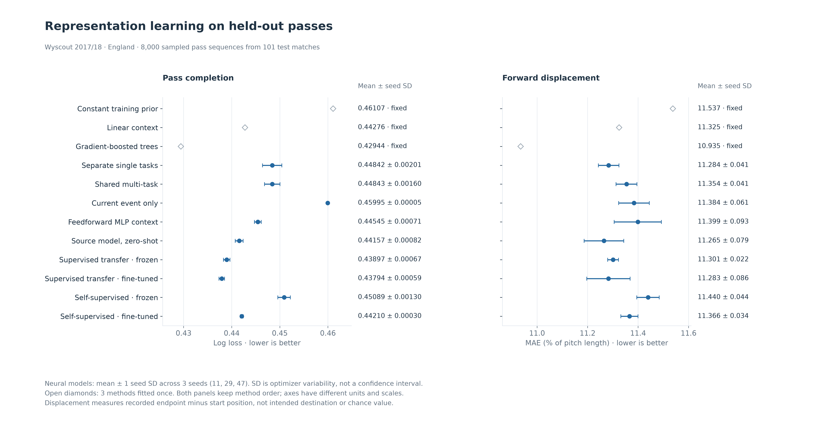
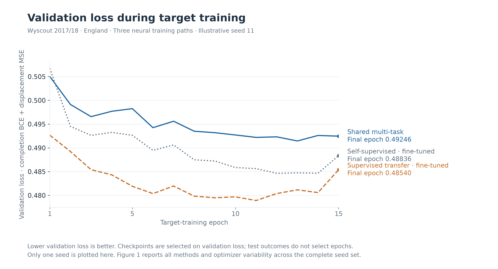
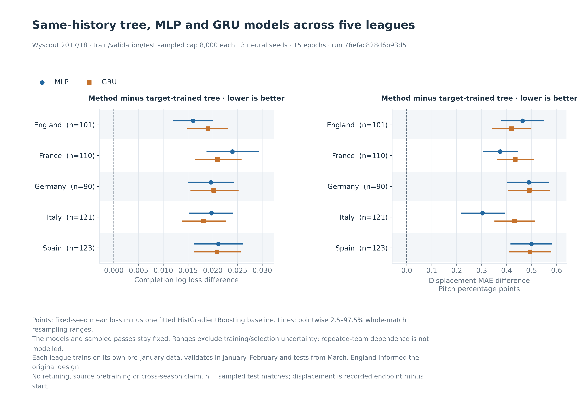

# 事件表示学习的首轮实验

实验最初执行于 2026-10-14，2026-10-15 用相同数据补充了梯度提升树和前馈 MLP，当前运行 ID 为 `f94ded4a65f37938`。使用本地 Wyscout 五大联赛 2017/18，原始来源为 Pappalardo 等整理的[公开事件数据](https://doi.org/10.6084/m9.figshare.c.4415000)。实际执行三个随机种子，包含迁移学习、多任务与自监督对照。[汇总及代码指纹](representation-learning.json)记录输入资产指纹、参数和环境。当前逐种子结果、测试预测与数值权重保留在 `.tmp/representation-paired-20261015/run`；树/MLP 补充运行 `26688ea7dbcc5f5a` 保留在 `.tmp/representation-baselines-20261015/run`；原运行 `8b8e5f30368500cb` 的完整结果仍在 `.tmp/representation-lab/final-run`。

## 网络学习什么

每个输入包含最近八个按时间排序的事件，跨球队保留上下文，跨比赛或半场时清空。每个事件只提供类型、起点坐标、相对当前时刻的间隔和是否与当前传球队同队。对手坐标旋转到当前球队的进攻方向。事件类型经过可学习的 embedding，再与数值输入进入 32 维 GRU。

编码器学习如何组合这些观察，人工没有预先指定压迫模式、推进次数或球队风格标签。任务头预测传球完成和记录到的向前位移。当前传球的终点、完成标签、球员 ID、球队 ID、游戏评分都不作为输入。向前位移是终点 x 减起点 x 的记录值，不是意图目的地、机会创造价值或球员能力。

自监督阶段只遮挡并重建事件类型和起点，任务标签不进入这个阶段。它采用事件序列上的遮挡重建，借用了[遮挡自编码器的思路](https://arxiv.org/abs/2111.06377)，没有复现该视觉论文的 ViT、图像块或非对称解码器。共享编码器配多个任务头的背景见[多任务学习综述](https://arxiv.org/abs/1706.05098)。冻结和微调两种迁移方式参照 [PyTorch 的迁移学习说明](https://docs.pytorch.org/tutorials/beginner/transfer_learning_tutorial.html)。

## 时间与数据窗口

自监督对照使用同一批来源序列，没有增加额外未标注样本。来源序列按任务标签与坐标是否完整筛选，但自监督损失不读取这些任务标签。

| 用途 | 范围 | 比赛数 | 可用传球序列 | 实际抽样 |
| --- | --- | ---: | ---: | ---: |
| 来源预训练 | 法、德、意、西，2017-08-04 至 2017-12-30 | 700 | 596,256 | 16,000 |
| 目标训练 | 英格兰，2017-08-11 至 2017-12-31 | 209 | 181,180 | 8,000 |
| 验证 | 英格兰，2018-01-01 至 2018-02-25 | 70 | 59,421 | 8,000 |
| 测试 | 英格兰，2018-03-01 至 2018-05-13 | 101 | 88,056 | 8,000 |

抽样先按比赛日期划分，再用固定随机数均匀选择各组传球序列。同一比赛不会跨训练、验证和测试，来源预训练也不使用目标验证期之后的数据。训练内部允许重叠上下文。这里统计的可用序列经过准确性标签与坐标完整性过滤，数量不是所有传球。

三个种子是 11、29、47。各训练阶段为 15 个 epoch，batch 为 256，Adam 学习率 0.003。自监督遮挡率 0.35。多任务损失为完成 BCE 加归一化位移 MSE，两项权重均为 1。目标训练按验证损失选 epoch，测试集不参与选参。线性基线使用相同八事件输入的固定展开，标准化仅在目标训练集拟合，分类 C 为 0.1，Ridge alpha 为 10。

补充基线使用与 GRU 相同的八事件可观测历史。树模型与 MLP 把事件类型作固定 one-hot，再与数值字段展开；GRU 使用可学习 embedding。树模型分别拟合分类和回归，100 轮、最多 15 个叶节点、学习率 0.05、L2 为 1、种子为 11，关闭内部随机验证和早停。MLP 为一层 32 单元 ReLU 加两个共享任务头，复用 GRU 的 Adam、batch、15 个 epoch、联合损失和验证集 checkpoint 选择。标准化仍只用于原线性基线。这些参数在读取本轮测试分数前固定，没有按测试结果调参；相同输入不意味着相同架构或计算预算。

## 测试结果

两个指标均为越低越好。表中误差是三个种子之间的标准差，不能解释为比赛样本的不确定性或置信区间。均值、线性和树模型各拟合一次，表中标为“固定”；MLP 与 GRU 均使用三个种子。

| 方法 | 传球完成 log loss | 向前位移 MAE，球场长度百分比 |
| --- | ---: | ---: |
| 训练集均值 | 0.4611（固定） | 11.537（固定） |
| 线性上下文基线 | 0.4428（固定） | 11.325（固定） |
| 梯度提升树上下文 | 0.4294（固定） | 10.935（固定） |
| 两个独立单任务 GRU | 0.4484 ± 0.0020 | 11.284 ± 0.041 |
| 共享多任务 GRU | 0.4484 ± 0.0016 | 11.354 ± 0.041 |
| 移除历史，只用当前事件 | 0.4600 ± 0.0000 | 11.384 ± 0.061 |
| 前馈 MLP 上下文 | 0.4454 ± 0.0007 | 11.399 ± 0.093 |
| 其他四个联赛直接迁移 | 0.4416 ± 0.0008 | 11.265 ± 0.079 |
| 有标签预训练，冻结编码器 | 0.4390 ± 0.0007 | 11.301 ± 0.022 |
| 有标签预训练，微调 | 0.4379 ± 0.0006 | 11.283 ± 0.086 |
| 自监督预训练，冻结编码器 | 0.4509 ± 0.0013 | 11.440 ± 0.044 |
| 自监督预训练，微调 | 0.4421 ± 0.0003 | 11.366 ± 0.034 |



本轮树模型的完成 log loss 为 0.4294，低于有标签预训练后微调 GRU 的 0.4379，位移 MAE 也更低。普通 MLP 为 0.4454，没有超过线性基线的 0.4428。这个固定样本说明，加入更强的同输入基线后，现有深度模型的优势需要重新判断。这里只比较记录到的两个目标，不据此声称未来赛季优势或因果效果。

只用当前事件的 GRU 为 0.4600，加入历史后为 0.4484，说明这个对照中上下文有帮助。其他联赛直接迁移消耗了两倍的来源训练样本，不能将差异全部归因于迁移方法。

共享多任务模型没有稳定超过两个独立模型。自监督微调接近线性基线，冻结的自监督表示更弱。本轮不能据此判定多任务或自监督普遍无效，任务关联、固定损失权重、预训练目标和数据量都可能影响结果。数据尚未支持稳定的效果显著性结论。

### 按整场测试比赛配对重采样

101 场测试比赛各保留了 50–119 个抽样传球。这里借鉴[整簇 case bootstrap 的定义](https://journal.r-project.org/articles/RJ-2023-015/)，使用 SciPy 的配对百分位重采样，固定 2,000 次和种子 20261015。每次有放回抽取 101 场比赛，把对应传球的损失差求和，再除以抽到的传球数；没有把各场均值等权平均。

差值为各方法减去梯度提升树，正值表示误差更大。多种子模型先逐传球平均三个固定种子的损失，再与树模型相减，没有把概率平均成集成模型。模型、种子、checkpoint 和这批抽样传球均保持固定，重采样中不再训练或选模型。

下表列出差值及逐项 2.5%–97.5% 范围；完整 11 个方法、3 个指标的 33 项比较见汇总 JSON 和研究页，Brier 也保留在其中。范围是条件敏感性分析，不是同时置信带、覆盖率认证或显著性判断。

| 方法减去树基线 | 完成 log loss 差值 [范围] | 位移 MAE 差值，百分点 [范围] |
| --- | ---: | ---: |
| 训练集均值 | 0.031637 [0.026454, 0.036911] | 0.6028 [0.4756, 0.7313] |
| 线性上下文 | 0.013322 [0.008974, 0.017768] | 0.3904 [0.3104, 0.4735] |
| 两个独立单任务 GRU | 0.018978 [0.014817, 0.023129] | 0.3488 [0.2695, 0.4275] |
| 共享多任务 GRU | 0.018993 [0.014850, 0.023081] | 0.4196 [0.3421, 0.4997] |
| 只用当前事件 | 0.030515 [0.025626, 0.035347] | 0.4492 [0.3618, 0.5373] |
| 前馈 MLP | 0.016012 [0.012022, 0.020004] | 0.4642 [0.3791, 0.5483] |
| 其他联赛直接迁移 | 0.012133 [0.007695, 0.015958] | 0.3303 [0.2572, 0.4085] |
| 有标签预训练，冻结 | 0.009535 [0.005679, 0.013163] | 0.3662 [0.2866, 0.4480] |
| 有标签预训练，微调 | 0.008504 [0.004949, 0.011986] | 0.3481 [0.2681, 0.4305] |
| 自监督预训练，冻结 | 0.021457 [0.017195, 0.025781] | 0.5048 [0.4222, 0.5980] |
| 自监督预训练，微调 | 0.012659 [0.008820, 0.016548] | 0.4311 [0.3565, 0.5117] |

这些比较是在先前测试对照后以树模型为参照进行的事后探索。固定模型的整场重采样未覆盖训练、选参、种子总体或场内再次抽样的不确定性，也没有建模重复球队的跨场相关与时间漂移。因此不将范围直接解释为未来赛季的效果。



本次重跑的 24 条原有 GRU 评估、两个原有固定基线及全部原有训练曲线与初次结果完全一致。新增树模型和三个种子的 MLP 又独立重跑，指标与 MLP 曲线也完全一致。新增配对分析复跑后，这 30 条评估、三个逐种子文件与上一轮完全一致；私有测试预测还能逐项重算全部测试分数。当前共 12 种方法、30 条评估，其中 27 条来自三个种子的神经网络。模型权重为数值 NPZ，使用 `allow_pickle=False` 读取，六个保存文件分别对应三个种子的共享多任务与自监督微调模型。它们便于后续复用，不覆盖比赛预测的模型文件。

### 固定参数扩展到五个联赛

另做的[五联赛对照](representation-leagues.json)使用运行 `76efac828d6b93d5`，保留原英格兰12方法实验。这里比较均值、线性、树基线，以及各用三个种子的MLP和共享GRU，共45条评估。每个目标联赛用自身2018年1月前的数据训练、1–2月验证、3月起测试，各分区最多抽样8,000次传球，不做来源预训练。数据加载器仍执行原有来源抽样，以保持目标样本选择一致。

下表为测试完成log loss，越低越好；神经模型为三个固定种子的均值，树模型拟合一次。测试合计545场、40,000次抽样传球。完整分区、种子标准差、Brier和位移MAE见汇总。

| 目标联赛 | 测试比赛 | 树基线 | MLP | 共享GRU |
| --- | ---: | ---: | ---: | ---: |
| 英格兰 | 101 | 0.4294 | 0.4454 | 0.4484 |
| 法国 | 110 | 0.4128 | 0.4367 | 0.4338 |
| 德国 | 90 | 0.4416 | 0.4612 | 0.4618 |
| 意大利 | 121 | 0.4213 | 0.4410 | 0.4394 |
| 西班牙 | 123 | 0.4174 | 0.4384 | 0.4382 |



五个联赛的树模型在完成log loss和位移MAE上均低于所比较的MLP和GRU。图中负差值表示误差更低，横线是固定模型的逐项整场重采样范围，未包含训练和选模不确定性。英格兰已参与架构与参数设计，其余联赛的扩展没有重新调参；架构容量、类型编码与计算预算仍不同。这是同赛季的比较，不能证明跨赛季优势，也没有检验所有深度模型。

本轮读取的1,826场目标比赛中，有1,565,356次名称为 `Pass` 的事件，其中1,565,354次通过标签与几何筛选。德国验证集有两次传球的y坐标为101，一次在起点、一次在终点，均由原有筛选排除。英格兰9条评估与原运行完全一致，保存的11个标签、比赛归属及预测数组也一致。45条测试评分均可从私有预测重算，60项配对范围另用NumPy整场抽样核对，最大差约5.0×10⁻¹⁶。源数据库只读，没有替换比赛预测模型。

## 复现与后续使用

```bash
python -m pip install -r requirements-deep-learning.txt --index-url https://download.pytorch.org/whl/cpu
python -m app.research representation-lab --epochs 15 --train-cap 8000 --seeds 11,29,47 --output-dir .tmp/representation-paired-20261015/run
python -m app.research export-research --experiment-report .tmp/representation-paired-20261015/run/summary.json
```

```python
import torch
from app.analytics.representation.data import pass_sequences
from app.analytics.representation.models import load_model

model = load_model('.tmp/representation-paired-20261015/run/self_supervised_finetune-seed-11.npz')

def encode_context(ordered_events):
    tokens, values, _ = pass_sequences(ordered_events)
    with torch.no_grad():
        states = model.encoder(torch.from_numpy(tokens), torch.from_numpy(values))
    return states[:, -1]
```

下一步可以将学习到的上下文接到球员习惯与对手准备档案，再做跨赛季验证。更高要求的跑位和压迫表示，需要补充连续追踪或覆盖足够的 360。已有模型不包含真实体能状态、完整无球轨迹或教练意图，没有用它们给小妖排名。

常规研究命令会把汇总、逐种子曲线、数值权重与两张图归档到统一数据库，`documents` 保存结构化报告，`analysis_run_assets` 连接运行与资产。本次补充直接调用 `experiment.run`，只读源数据库，当前新结果保存在上述目录并导出汇总与图表，尚未写入数据库归档。机构方法的短摘要也已归档，完整来源文章没有复制进公开目录。

预训练增加了数据和计算量，独立单任务使用两个编码器。这轮没有做等计算预算对照，也没有调整超参数追逐测试分数。各方法都保留在结果中，实验结论限定在这份历史样本和两个任务。
